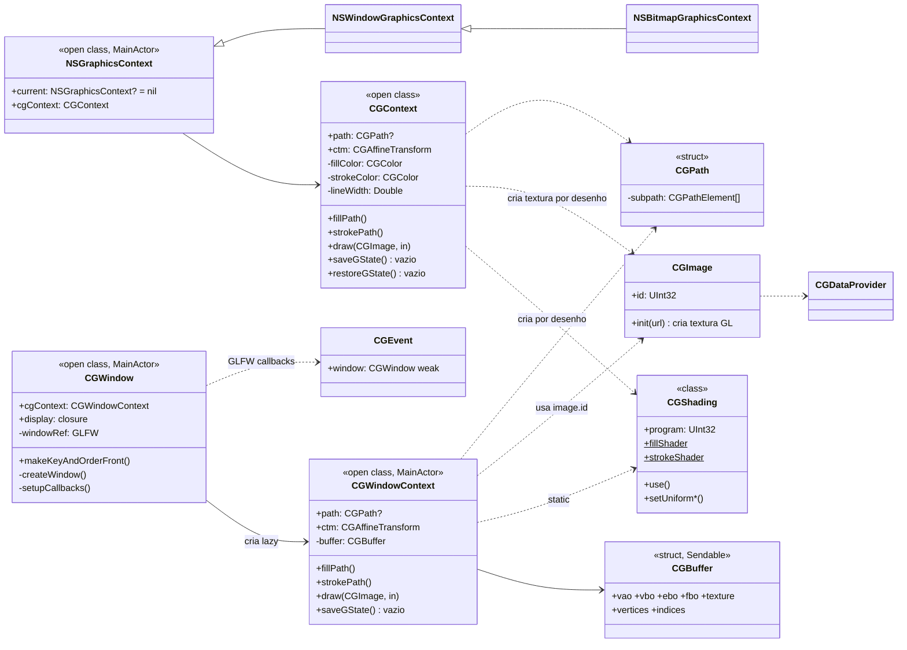
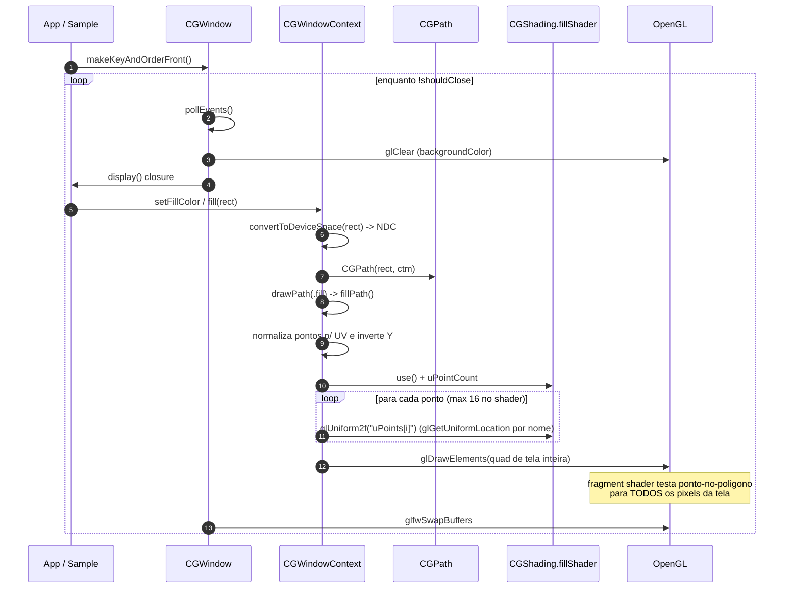
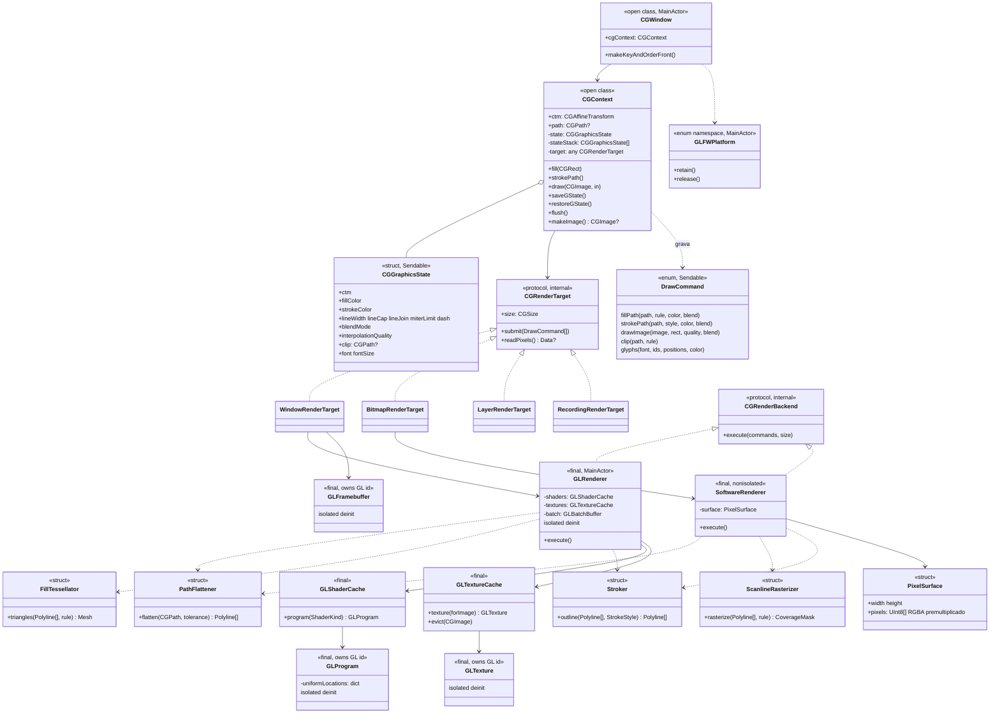
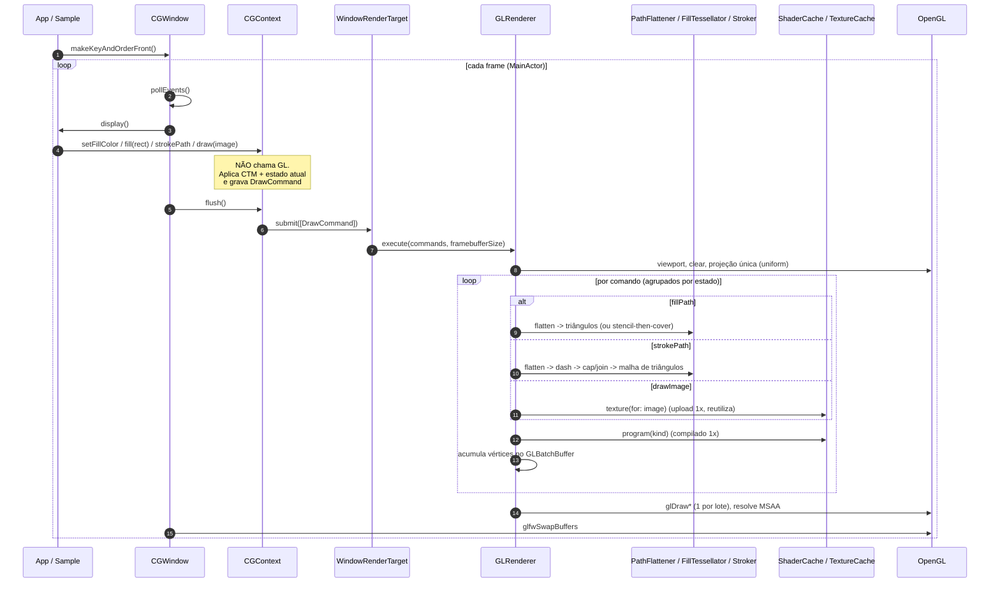

# ADR 0001 — Análise arquitetural e plano de reestruturação do OpenCoreGraphics

| Campo | Valor |
|---|---|
| **Status** | **Aceita** (decisões da seção 11 incorporadas em 2026-11-09) |
| **Data** | 2026-11-09 |
| **Escopo** | Orientação a Objetos, Arquitetura, Pipeline de Renderização, Concorrência, Build/Testes |
| **Base de análise** | Working tree sobre o commit `b9f9baa` (branch `main`), Swift 6.4, OpenGL 3.3 Core via OpenGLAD/OpenGLFW/OpenSTB |
| **Substitui** | — |
| **Relacionadas** | [ADR 0002 — Backend de renderização em software (bitmap sem OpenGL)](0002-backend-de-renderizacao-em-software.md) |

---

## 1. Resumo executivo

O OpenCoreGraphics reimplementa a API do Core Graphics da Apple sobre OpenGL para Windows e Linux. A **superfície pública** (tipos geométricos, `CGColor`, `CGPath`, nomes dos métodos de `CGContext`) está bem alinhada com a API original e bem documentada. O **miolo de renderização**, porém, ainda é um protótipo: a lógica de desenho está espalhada em chamadas OpenGL imediatas dentro de métodos de contexto, há duas cópias quase idênticas de `CGContext`, e o resultado visual hoje é incorreto ou inexistente para traço (`stroke`), elipses, imagens e estado gráfico.

**Resposta curta às perguntas feitas:**

| Pergunta | Resposta |
|---|---|
| É possível reestruturar? | **Sim.** A API pública do `CGContext` é preservada; as poucas mudanças de declaração estão na seção 8.2. Cerca de metade do código (geometria, cores, enums, `CGPath`, `CGEvent`, ~2 400 de ~5 400 linhas) pode ser mantida. As ~2 100 linhas de `CGContext`/`CGWindowContext`/`CGShading`/`CGBuffer` devem ser reorganizadas. |
| Qual a mudança mais importante? | Separar **"o que desenhar"** (API `CGContext` + estado gráfico + comandos) de **"como desenhar"** (backend OpenGL). Hoje os dois estão fundidos. |
| Precisa reescrever tudo? | Não. Migração **incremental** (padrão *strangler*). A regra do `AGENTS.md` de não alterar declarações foi relaxada onde necessário para o framework funcionar (Q2) existentes. |
| O que bloqueia hoje? | O pacote **não compila** (`CGShading.swift:111`) e os testes de `CGPath` não compilam. A Fase 0 corrige isso. |

**Decisão:** adotar uma arquitetura em camadas com **gravação de comandos (display list) + backend de renderização plugável**, tesselação de caminhos feita na CPU, preenchimento por *stencil-then-cover*, *batching* de geometria, cache de shaders/texturas e propriedade explícita dos recursos OpenGL. Detalhes nas seções 5 e 6. Para o cenário sem contexto OpenGL, veja a ADR 0002 (backend em software).

---

## 2. Contexto

### 2.1 Objetivo do projeto

Conforme `AGENTS.md` e `README.md`: fornecer um framework para Windows e Linux que renderize componentes 2D com OpenGL e Swift, espelhando o Core Graphics (paths, transformações, cores, offscreen, imagens, shadings, eventos e janelas).

### 2.2 Restrições vigentes (`AGENTS.md`)

Estas regras condicionam **como** reestruturar e são tratadas como requisitos:

| # | Regra | Impacto na decisão |
|---|---|---|
| R1 | Não alterar declarações existentes de tipos, funções e propriedades | **Relaxada (Q2):** preferir mudanças aditivas, mas alterar ou remover declarações é permitido quando necessário para o framework funcionar. Lista na seção 8.2 |
| R2 | Novas funções devem ser `private` | Novos **tipos** internos são permitidos (e necessários); a lógica nova deve expor o mínimo possível |
| R3 | Chamadas OpenGL usam OpenGLAD (`glad_*`) | Todo `glad_*` fica confinado à camada de backend (`GL*`) |
| R4 | Sem comentários de código; documentação `///` obrigatória e didática | Vale também para os novos tipos |
| R5 | Cobertura mínima de 80 % | Exige arquitetura **testável sem contexto GL** (seção 9) |
| R6 | Usar `/swift-testing-pro` e `/swift-concurrency-pro` | Aplicadas nas seções 6.6 e 9 |
| R7 | ADRs com Class Diagram e Sequence Diagram em Mermaid | Seções 4.2, 4.3, 6.3 e 6.4 |

> **Resolvido (Q1):** o `AGENTS.md` foi corrigido; ADRs ficam em `.docs/ADRs/`.

### 2.3 Estado do build e dos testes (verificado)

| Verificação | Resultado |
|---|---|
| `swift build` | **Falha.** `CGShading.swift:111` — `glad_glUniform4f` recebe `Double` (`CGColor.components` virou `[Double]`) onde espera `Float` |
| `swift test` | Não executável enquanto o build falha. Pela leitura, `Tests/.../2D Drawing/CGPathTests.swift` usa `let path = CGPath()` e chama métodos `mutating` (`CGPath` é `struct`), então **também não compila** |
| `CGContextTests` / `OpenCoreGraphicsTests` | Vazios |
| Cobertura | Não medida; pela leitura, restrita a `CGPath`. Muito abaixo dos 80 % exigidos |
| `main.swift` (Sample) | Não desenha nada: `NSGraphicsContext.current` é sempre `nil` e nunca é atribuído |

---

## 3. Mapa do código atual

| Área | Arquivos | Linhas | Situação |
|---|---|---:|---|
| Geometria | `CGPoint`, `CGSize`, `CGRect`, `CGVector`, `CGAffineTransform` | ~1 200 | Sólida; ver A-6 (matriz 4×4) |
| Cor | `CGColor`, `CGColorSpace`, enums | ~200 | Funcional; `CGColorSpace` é `enum` fechado |
| Caminho | `CGPath` | 541 | Parcial; stubs e bugs (R-8) |
| Contexto | `Services/Window Services/CGContext.swift` | 951 | **Duplicado** de `CGWindowContext`; GL imediato por chamada |
| Contexto de janela | `CGWindowContext.swift` | 872 | Cópia de `CGContext` com outro backend |
| Janela/Eventos | `CGWindow`, `CGEvent` | 297 / 194 | Funcional; responsabilidades misturadas |
| GL | `CGShading` (292), `CGBuffer` (32) | 324 | Shaders duplicados; GL vazando para API pública |
| Imagem | `CGImage` (172), `CGDataProvider` (56) | 228 | Cria textura no `init`; ver R-5 |
| Texto | `CGFont` (139), `CGGlyph` | 149 | Stub com código comentado |
| NSGraphicsContext | 3 arquivos | 68 | Esqueleto; herança incorreta (O-5) |
| Display | `CGDisplay` | 0 | Vazio |
| Resources | `default/vertex.glsl`, `fragment.glsl` | 0 | Vazios e não declarados no `Package.swift` |
| Testes | 3 arquivos | ~150 | Quase tudo é `CGPath` |

---

## 4. Diagnóstico

### 4.1 Legenda de severidade

**Crítica** = impede compilar/usar ou produz resultado errado em caso comum. **Alta** = bloqueia evolução ou causa bugs recorrentes. **Média** = dívida técnica. **Baixa** = polimento.

### 4.2 Arquitetura atual (as-is)



**Observações-chave do diagrama:** `CGWindowContext` **não** é subtipo de `CGContext`, então `NSGraphicsContext.cgContext: CGContext` nunca consegue envolver o contexto da janela; `NSBitmapGraphicsContext` herda de `NSWindowGraphicsContext` (invertido); `CGShading` é consumido de forma estática *e* instanciada por desenho.

### 4.3 Pipeline de renderização atual (as-is)



### 4.4 Achados — Orientação a Objetos

| ID | Sev. | Achado | Evidência |
|---|---|---|---|
| **O-1** | Crítica | **Duplicação massiva.** `CGContext` e `CGWindowContext` têm ~90 % do código idêntico (transformações, path, cores, texto, CTM). Qualquer correção precisa ser feita duas vezes e as cópias já divergem (ex.: `fillEllipse` converte o rect em uma e não na outra; conversão de espaço usa fórmulas inversas) | `CGContext.swift:46-137` × `CGWindowContext.swift:53-150`; `fillEllipse`: `CGContext.swift:491` × `CGWindowContext.swift:492` |
| **O-2** | Alta | **Classe-deus.** Cada contexto mistura: API pública, estado gráfico, construção de path, conversão de coordenadas, tessellação, upload de buffers, compilação de shader e emissão de draw calls. Viola SRP | `CGContext.swift:351-449` |
| **O-3** | Alta | **Herança onde deveria haver composição.** Os "tipos" de contexto (janela, bitmap, layer) são modelados como cópias da classe, não como *destinos de renderização* intercambiáveis. Não há abstração de *render target* | `CGWindowContext` vs `CGContext`; `CGLayer.swift:15` aceita só `CGContext` |
| **O-4** | Alta | **Estado gráfico não existe como tipo.** Cor, linha, fonte, blend, CTM etc. são propriedades soltas; `saveGState`/`restoreGState` estão **vazios**. Sem pilha de estados não há `CGLayer`, clipping nem composição correta | `CGContext.swift:863-870`, `:889-890` |
| **O-5** | Média | **Hierarquia invertida:** `NSBitmapGraphicsContext : NSWindowGraphicsContext`. Irmãos viraram pai/filho | `NSBitmapGraphicsContext.swift:4` |
| **O-6** | Média | **Tipos "stringly-typed":** `CGBitmapParameters` usa `@dynamicMemberLookup` com `[String: Any]` e `as!` — perde tipagem, é não-`Sendable` e pode crashar em runtime | `CGBitmapParameters.swift:3-15` |
| **O-7** | Média | **`CGColorSpace` é `enum` fechado** (4 casos). A API real é um tipo opaco com nome, modelo e nº de componentes. O novo enum `CGColorModel` existe mas não é usado | `CGColorSpace.swift:25`; `CGColorModel.swift` |
| **O-8** | Média | **Superfície `open` excessiva.** Métodos como `drawPath`, `fillPath`, `fill`, `clear` são `open`: subclasses podem quebrar invariantes internas (ex.: `drawPath` chama `fillPath` virtual) | `CGContext.swift:327-351` |
| **O-9** | Baixa | **Vazamento de detalhes GL na API pública:** `CGBuffer` é `public` e expõe `vao/vbo/ebo/fbo`; `CGShading` é `public` | `CGBuffer.swift:3`, `CGShading.swift:5` |
| **O-10** | Baixa | **Semântica de `CGEvent`:** `keyEvent` usa `scanCode` como `keyCode` e ignora `key`; arrastar do mouse é inferido de `action == 2`, que em GLFW não existe para botões | `CGEvent.swift:12-35` |

### 4.5 Achados — Arquitetura

| ID | Sev. | Achado | Evidência |
|---|---|---|---|
| **A-1** | Crítica | **Sem camadas.** Geometria, estado, lógica de desenho, OpenGL, janela e eventos compartilham o mesmo módulo e se referenciam livremente. O `CGContext` "puro" depende de `OpenGLAD` | `CGContext.swift:2` |
| **A-2** | Crítica | **Não testável sem GPU.** Como cada método de desenho chama `glad_*`, testar `fill(_:)` exige janela e contexto GL. Isso inviabiliza a meta de 80 % de cobertura | todos os métodos de desenho |
| **A-3** | Alta | **Dois sistemas de coordenadas contraditórios.** `convertToDeviceSpace` retorna **NDC [-1,1]** (não pixels) e as duas classes usam fórmulas inversas; o fill ainda inverte Y manualmente em `fillPath`. `userSpaceToDeviceSpaceTransform` (ortográfica) existe mas **não é usada** | `CGContext.swift:54-62` × `CGWindowContext.swift:61-70`; `:371-376` |
| **A-4** | Alta | **Janela dona de tudo.** `CGWindow` inicializa GLFW (`glfwInit` por janela), cria o contexto GL, carrega GLAD, traduz eventos, roda o loop e cria o contexto de desenho | `CGWindow.swift:164-187`, `:88-97` |
| **A-5** | Alta | **Ciclo de vida GLFW incorreto:** `deinit` de **qualquer** janela chama `glfwTerminate()`, destruindo todas as outras; `title` é lido em `glfwCreateWindow` antes de existir janela (sempre `""`) | `CGWindow.swift:19-21`, `:229-231`, `:175` |
| **A-6** | Média | **`CGAffineTransform` é matriz 4×4** com entradas `internal` (`m11…m44`), inclui `perspective(...)`, e **não expõe `a, b, c, d, tx, ty`** nem `init(a:b:c:d:tx:ty:)`. Isso foge da API original (3×3) e dificulta portar código Apple. **Decisão (Q6):** manter 4×4 para evoluir para 3D; apenas acrescentar acessores 2D aditivos (`a, b, c, d, tx, ty`) | `CGAffineTransform.swift:4-55`, `:553` |
| **A-7** | Média | **Ordem da CTM inconsistente:** `scaleBy` faz `scaling * ctm`; `translateBy` faz `ctm * translation`; `concatenate` faz `ctm.concatenating(t)`, mas a doc diz `transform * ctm` | `CGContext.swift:818`, `:827`, `:837` |
| **A-8** | Média | **Métodos de path do contexto ignoram a CTM de forma inconsistente:** `addLine/addRect/addEllipse/addPath` aplicam `ctm`; `addArc`, `addCurve`, `addQuadCurve`, `addArc(tangent…)` **não** aplicam | `CGContext.swift:160-276` |
| **A-9** | Média | **Colisão de nomes no macOS:** os tipos `CGPoint`, `CGRect`, `CGContext` etc. coexistem com os do `CoreGraphics` re-exportados por `Foundation`. Compila por sombreamento, mas qualquer app que importe ambos terá ambiguidade. **Decisão:** manter o prefixo `CG` (ver seção 11); verificar em Linux/Windows se o `Foundation` também exporta tipos homônimos (ex.: `CGFloat`, `CGPoint`) | todos os arquivos com `import Foundation` |
| **A-10** | Média | **Build/empacotamento:** dependências por `branch: "main"` (não reprodutível); `Package.resolved` está no `.gitignore`; o executável de exemplo é publicado como *product*; `Resources/` existe mas não é declarado; `Package@swift-6.1.swift` foi removido (suporte a 6.1/6.2 perdido); sem `platforms` | `Package.swift`, `.gitignore` |
| **A-11** | Baixa | **Organização por pastas da Apple (`Services/Window Services/CGContext.swift`):** `CGContext` está em "Window Services", e `CGLayer` (struct) não tem implementação | estrutura de diretórios |

### 4.6 Achados — Pipeline de Renderização

| ID | Sev. | Achado | Evidência |
|---|---|---|---|
| **R-1** | Crítica | **Traço (`stroke`) é na verdade preenchimento.** `strokeShader` é byte-a-byte igual ao `fillShader`; `lineWidth` é ignorado em `CGWindowContext`. `strokePath()` pinta o polígono preenchido | `CGShading.swift:189-293`; `CGWindowContext.swift:410-450` |
| **R-2** | Crítica | **Preenchimento limitado a 16 vértices** (`MAX_POINTS 16`) e por ponto-no-polígono em *fragment shader* para **todos os pixels da tela** (*quad* fullscreen por chamada). Custo O(pixels × vértices); curvas Bézier viram polígonos com pontos de controle (sem *flattening*), então elipses saem erradas. O modo `evenOdd/winding` (`rule`) é ignorado | `CGShading.swift:206`, `:215-228`; `CGWindowContext.swift:364-404` |
| **R-3** | Alta | **Upload de uniformes por vértice:** `glGetUniformLocation` por nome a cada `setUniform` (até 16×/fill), sem cache de *location* | `CGWindowContext.swift:387-390`; `CGShading.swift:90-112` |
| **R-4** | Alta | **Recursos GL criados e destruídos a cada desenho** (no `CGContext` antigo): VAO + VBO + programa compilado/linkado por `fill`; textura + mipmaps por `draw(image)`. Pior: o array `vertices` **acumula entre subpaths** sem ser zerado dentro do `forEach` | `CGContext.swift:355-393`, `:549-603`, `:381` |
| **R-5** | Crítica | **`CGImage(url:)` está quebrado:** (i) `defer { glDeleteTextures }` apaga a textura ao fim do `init`; (ii) `id` é variável **local** que sombreia a propriedade — `self.id` permanece 0; (iii) `dataProvider.info = image` guarda um ponteiro que é liberado por `stbi_image_free`; (iv) usa `fatalError` em vez de *failable init*; (v) formato é decidido por `colorSpace == .sRGB` em vez de nº de canais (1/2 canais ficam incorretos); (vi) cria GL em um inicializador de valor de imagem, acoplando imagem a contexto GL | `CGImage.swift:55-95`; `CGContext.swift:570` |
| **R-6** | Alta | **`draw(_:in:)` do `CGWindowContext` ignora o `rect`** (código comentado) e desenha o VAO de tela cheia; `byTiling` ignorado; `interpolationQuality` e `shouldInterpolate` não influenciam filtros | `CGWindowContext.swift:538-557` |
| **R-7** | Alta | **Blend/alpha:** blend fixo `SRC_ALPHA, ONE_MINUS_SRC_ALPHA` (não pré-multiplicado) enquanto o bitmap padrão é `premultipliedLast`; `CGBlendMode` nunca é aplicado; `renderingIntent` e `fillColorSpace/strokeColorSpace` são gravados mas **nunca usados** | `CGContext.swift:889-905`, `:42` |
| **R-8** | Alta | **`CGPath` incompleto/incorreto:** `closeSubpath` zera `currentPoint` (deveria voltar ao início do subpath); `copy()`, `copy(using:)` retornam `nil`; `contains` retorna sempre `false`; `boundingBox`/`boundingBoxOfPath` nunca são atualizados; `addArc` ignora `clockwise`, não conecta ao ponto atual e usa 8 segmentos fixos; `addArc(tangent…)` é só duas linhas; `addLines` não faz `move` do primeiro ponto; `addRectToPoint` é um elemento não-padrão que obriga o renderizador a tratá-lo como caso especial | `CGPath.swift:81-122`, `:315-347`, `:436-440` |
| **R-9** | Alta | **Sem clipping, sem anti-aliasing, sem sombra, sem gradiente/pattern, sem dash/cap/join/miter.** `glLineWidth` > 1 não é garantido em *core profile* (largura máxima pode ser 1 em vários drivers), portanto o caminho `GL_LINE_LOOP` antigo não é confiável | `CGContext.swift:436` |
| **R-10** | Média | **Loop de render sem *damage tracking*:** `viewsNeedDisplay` é `true` fixo, `display()` roda a todo frame; redimensionar a janela atualiza `frame` mas **não** o `width/height` do contexto nem a projeção (só o `glViewport`) | `CGWindow.swift:113`, `:291-297` |
| **R-11** | Média | **Shaders em strings Swift duplicadas** (`.fill` e `.stroke` idênticos; dois pares estáticos idênticos) enquanto `Resources/default/*.glsl` está vazio | `CGShading.swift:115-186` × `:189-293` |
| **R-12** | Baixa | **Cores:** `CGColor.black/white/clear` documentadas como "gray" mas criadas em RGB linear; sem conversão `sRGB ↔ linear` nem `GL_FRAMEBUFFER_SRGB` definido | `CGColor.swift:89-96` |

### 4.7 Achados — Concorrência (`/swift-concurrency-pro`)

O contexto OpenGL é **afim a uma thread** (a que chamou `glfwMakeContextCurrent`). Isso deve guiar o modelo de isolamento.

| ID | Sev. | Achado | Evidência |
|---|---|---|---|
| **C-1** | Alta | **Isolamento incoerente:** `CGWindow` e `CGWindowContext` são `@MainActor`; `CGContext`, `CGShading`, `CGImage`, `CGFont` e `CGEvent` não têm isolamento mas chamam GL diretamente. Em Swift 6 isso permite chamar GL de qualquer thread sem aviso | `CGContext.swift:8`, `CGImage.swift:8` |
| **C-2** | Alta | **`@preconcurrency import OpenGLAD`** em 7 arquivos suprime justamente os diagnósticos que protegeriam o uso de GL fora da thread correta | `grep @preconcurrency` |
| **C-3** | Alta | **`deinit` libera recursos GL fora do ator:** `CGShading.deinit` → `nonisolated delete()` → `glDeleteProgram`; `CGWindow.deinit` → `terminate()` `nonisolated`. O `deinit` pode rodar em qualquer thread. Swift 6.2 oferece `isolated deinit` para este caso | `CGShading.swift:20-22`, `:86-88`; `CGWindow.swift:19`, `:229` |
| **C-4** | Média | **`CGBuffer: Sendable` é enganoso:** guarda IDs de objetos GL que só valem na thread do contexto; ser `Sendable` convida a usá-lo em outra thread | `CGBuffer.swift:3` |
| **C-5** | Média | **Singletons GL estáticos** (`CGShading.fillShader`, `strokeShader`) são `@MainActor static let` criados no primeiro acesso: dependem implicitamente de já existir contexto GL corrente. Em teste ou com múltiplas janelas, o programa fica inválido | `CGShading.swift:190`, `:243` |
| **C-6** | Média | **Callbacks GLFW** (`@convention(c)`) chamam métodos `@MainActor` (`window.sendEvent`) via `Unmanaged` sem prova de isolamento; é correto só porque `glfwPollEvents` roda na main thread — vale registrar isso com `MainActor.assertIsolated()` | `CGWindow.swift:259-297` |

### 4.8 Achados — Qualidade, testes e documentação

| ID | Sev. | Achado |
|---|---|---|
| **Q-1** | Crítica | Build e testes quebrados (seção 2.3) |
| **Q-2** | Alta | Cobertura muito inferior a 80 %; `CGContextTests` vazio |
| **Q-3** | Média | `fatalError` em caminhos de erro previsíveis (arquivo de imagem inexistente, GLFW/GLAD falhando) em vez de erros tipados |
| **Q-4** | Média | Código morto/comentado em `CGWindow`, `CGWindowContext.draw`, `CGFont` e `main.swift`, contrariando a regra R4 |
| **Q-5** | Baixa | `print` de diagnóstico em `CGShading` e `CGFont`; sem *logging* estruturado |
| **Q-6** | Baixa | Documentação com referências Apple-específicas (`UIView`, ATS) copiadas e `///` incompletos em `CGImage.init(url:)`, `CGWindow.display`, `CGBuffer` |

---

## 5. Opções consideradas

| Opção | Descrição | Prós | Contras |
|---|---|---|---|
| **A. Remendar** | Corrigir bugs pontuais, manter as duas classes de contexto | Menor esforço imediato | Mantém duplicação, acoplamento a GL e ausência de testes; stroke/curvas/clipping continuam inviáveis |
| **B. Reestruturar de forma aditiva (escolhida)** | Introduzir camadas internas (estado, comandos, backend, tessellação); manter API pública por delegação; migrar por fases | Respeita R1/R2; entrega valor a cada fase; testável; sem *big bang* | Convivência temporária de código novo e antigo; exige disciplina nas fases |
| **C. Reescrita completa** | Novo módulo do zero, descartar o atual | Design limpo | Quebra R1; descarta cerca de metade do código, que é reaproveitável; alto risco e tempo sem entrega |

**Decisão: Opção B.**

---

## 6. Decisão — arquitetura-alvo

### 6.1 Princípios

1. **Um único `CGContext` público.** Janela, bitmap e layer diferem apenas pelo **destino de renderização**, não por cópias da classe.
2. **Desenhar não toca GL.** Chamadas de `CGContext` atualizam estado e **gravam comandos** (`DrawCommand`). O GL só é tocado ao *executar* a lista no backend.
3. **GL confinado.** Todo `glad_*` fica em tipos `GL*` internos, de uma única camada.
4. **Dono explícito de recursos GL.** Quem cria libera, no ator certo (`isolated deinit`).
5. **Abstrair só o que tem 2+ implementações reais** (`GLRenderer` e `RecordingRenderer` para testes). Evita *over-engineering*.
6. **Ordem de custo:** corretude → testabilidade → desempenho.

### 6.2 Camadas e dependências

```
┌─────────────────────────────────────────────────────────────────┐
│ 5. Plataforma     CGWindow · GLFWPlatform                       │  GLFW
├─────────────────────────────────────────────────────────────────┤
│ 4. Backend GL     GLRenderer · GLShaderCache · GLTextureCache   │  OpenGLAD
│                   GLBatchBuffer · GLRenderTarget(FBO/Default)   │
├─────────────────────────────────────────────────────────────────┤
│ 3. Geometria de   PathFlattener · FillTessellator · Stroker     │  (puro Swift)
│    render         Dasher · RenderPass planner                   │
├─────────────────────────────────────────────────────────────────┤
│ 2. Núcleo         CGContext · CGGraphicsState · DrawCommand     │  (puro Swift)
│                   CGLayer · CGPath · CGImage(dados)             │
├─────────────────────────────────────────────────────────────────┤
│ 1. Valores        CGPoint/Rect/Size/Vector · CGAffineTransform  │  (puro Swift)
│                   CGColor · CGColorSpace · enums                │
└─────────────────────────────────────────────────────────────────┘
   Regra: cada camada só depende das inferiores. As camadas 1–3 NÃO importam OpenGLAD/OpenGLFW.
   O SoftwareRenderer (ADR 0002) fica na camada 4, mas não depende de OpenGL.
```

As camadas 1–3 concentram a maior parte da lógica e são 100 % testáveis sem GPU — é o que viabiliza os 80 % de cobertura.

### 6.3 Diagrama de classes — alvo (to-be)



Pontos de decisão sobre o diagrama:

- **`CGWindowContext` e `CGWindow` são mesclados.** `CGWindow` passa a expor `cgContext: CGContext`. Para não quebrar quem já escreve `CGWindowContext`, mantém-se `public typealias CGWindowContext = CGContext` (marcado `@available(*, deprecated)`) e um `init(width:height:)` de conveniência em `CGContext`. Isso elimina a duplicação (O-1).
- **`NSGraphicsContext`, `NSWindowGraphicsContext` e `NSBitmapGraphicsContext` são removidos.** Eram esqueletos sem uso e `NSGraphicsContext.current` nunca era atribuído. O Sample passa a usar `window.cgContext` direto. Se um dia fizerem sentido, entram em uma ADR própria.
- **Eventos de janela ficam fora de escopo agora.** `CGEvent` permanece como está e `EventTranslator` não será criado nesta etapa.
- `CGRenderTarget` e `CGRenderBackend` são *internos*. `CGBuffer` e `CGShading` deixam de ser usados e são removidos ou rebaixados a `internal` (seção 8.2).
- `CGGraphicsState` é `struct` (semântica de valor): `saveGState` = *push de cópia*, `restoreGState` = *pop*. Resolve O-4 e viabiliza `CGLayer`.
- **Dois backends reais** (`GLRenderer` e `SoftwareRenderer`) justificam a abstração `CGRenderBackend`. O de software é detalhado na ADR 0002.

### 6.4 Pipeline de renderização — alvo (to-be)



### 6.5 Decisões técnicas de renderização

| Tema | Decisão | Resolve |
|---|---|---|
| **Espaço de coordenadas** | Uma única cadeia: *user space* → (`CTM`) → *device space em pixels* → (matriz de projeção ortográfica no *vertex shader*) → NDC. `convertToDeviceSpace` passa a devolver **pixels**; a inversão de Y é decidida por um único `isFlipped`, não por hacks no fill | A-3, A-7 |
| **CTM** | Composição única e documentada (`ctm = transform * ctm`, como a API original); métodos de path aplicam sempre a CTM | A-7, A-8 |
| **Curvas** | `PathFlattener`: subdivisão adaptativa (De Casteljau) com tolerância em pixels (ex.: 0,25 px) para Bézier cúbica/quadrática e arcos | R-2, R-8 |
| **Preenchimento** | **Stencil-then-cover** para `winding` e `evenOdd`: desenha o leque de triângulos no *stencil* (`INCR_WRAP/DECR_WRAP` ou `INVERT`) e cobre a *bounding box* com `stencil != 0`. Suporta côncavos, buracos e auto-interseção, sem limite de vértices e sem *quad* de tela inteira. Atalho: retângulo/convexo = 2 triângulos diretos | R-2 |
| **Traço** | `Stroker` na CPU gera o contorno (polígonos) do traço, que segue o mesmo caminho do preenchimento nos dois backends, para linhas com `lineWidth`, `lineCap`, `lineJoin`, `miterLimit` e *dash*. Não depende de `glLineWidth` | R-1, R-9 |
| **Clipping** | Pilha de clip em *stencil* (bit separado do usado no fill) ou escopo por `glScissor` quando o clip é retângulo | R-9 |
| **Anti-aliasing** | MSAA no framebuffer padrão (`GLFW_SAMPLES`) e renderbuffer multisample nos FBOs, com *resolve* antes do `readPixels` | R-9 |
| **Alpha e blend** | Pipeline **pré-multiplicado** (`ONE, ONE_MINUS_SRC_ALPHA`); `CGBlendMode` mapeado para equações de blend; modos não separáveis por *shader* com cópia do destino. Tabela de suporte documentada | R-7 |
| **Lotes** | `GLBatchBuffer`: VBO dinâmico (orphaning/ring) acumulando vértices com o mesmo estado (programa, textura, blend); *flush* ao mudar de estado ou no fim do frame | R-4 |
| **Shaders** | Compilados **uma vez** por `GLRenderer` (não por desenho nem como `static`), com cache de `uniform location`; GLSL vive em `Resources/` (Q5), declarado em `Package.swift` e carregado via `Bundle.module`; um par `vertex/fragment` por programa (`default/` = cor sólida, `image/` = textura; novos conforme necessário). Validação manual em Windows/Linux (sem CI por ora, Q7) | R-3, R-11, C-5 |
| **Imagens** | `CGImage` volta a ser **dado** (pixels + metadados). A textura é criada **sob demanda** no `GLTextureCache` (chave: identidade da imagem) e liberada por `isolated deinit`/evicção. `CGImage(url:)` passa a delegar a um decodificador interno e validar canais (1/2/3/4) | R-5, R-6 |
| **Bitmap/Layer** | `BitmapRenderTarget` usa o `SoftwareRenderer` (ADR 0002): não precisa de contexto OpenGL e é a semântica real do bitmap context da Apple. FBO + `readPixels` fica como opção futura. `CGLayer` = lista de comandos gravada, reexecutável (efeito de cache real) | O-3, A-1 |
| **Cor** | Converter `sRGB ↔ linear` em um só ponto; decidir `GL_FRAMEBUFFER_SRGB`; `CGColorSpace` ganha nome/modelo/nº de componentes (mantendo os 4 casos existentes) | R-12, O-7 |

### 6.6 Modelo de concorrência (`/swift-concurrency-pro`)

**Decisão:** toda interação com GL ocorre no **MainActor** (mesma thread da `glfwPollEvents` e do contexto corrente). Detalhes:

1. `GLRenderer`, `GLShaderCache`, `GLTextureCache`, `GLProgram`, `GLTexture`, `GLFramebuffer`, `CGWindow`: `@MainActor`.
2. **Liberar recursos GL com `isolated deinit`** (disponível: o pacote exige Swift 6.4, Q4) nos tipos que possuem IDs GL, substituindo `nonisolated deinit` + `delete()` (C-3).
3. `CGContext` **não** é `@MainActor` (como na API original, pode ser usado em qualquer thread, porém confinado a uma por vez) — ele apenas grava `DrawCommand` (valores `Sendable`). A execução (`flush`) acontece no `@MainActor`. Assim a API pública continua flexível e GL fica seguro.
4. `DrawCommand`, `CGGraphicsState`, `CGPath`, `CGColor`, `StrokeStyle`, `Mesh` = `Sendable` por valor. **`CGBuffer` deixa de ser `Sendable`** (C-4).
5. Remover `@preconcurrency import OpenGLAD` dos arquivos de núcleo; mantê-lo (ou criar um *wrapper*) **somente** na camada de backend, onde o isolamento é garantido (C-2).
6. Callbacks GLFW: fora de escopo por ora. Quando eventos voltarem, concentrar a ponte `Unmanaged` em `GLFWPlatform` com `MainActor.assertIsolated()` (C-6).
7. `@unchecked Sendable` **não** será usado.
8. **`defaultIsolation(MainActor.self)`: não adotar agora (Q3).** O target é único e a maior parte do código (camadas 1–3, `SoftwareRenderer`) precisa ficar livre de isolamento para rodar em qualquer thread e em testes. Com o padrão em `MainActor`, quase tudo exigiria `nonisolated` explícito. Anotar `@MainActor` apenas nos tipos GL e em `CGWindow` é mais simples e seguro. Reavaliar se o backend GL virar um target separado (`OpenCoreGraphicsGL`).

### 6.7 Plataforma e janela

Foco: **garantir a renderização com OpenGL**. Eventos ficam para depois.

- `CGWindow` absorve o papel de `CGWindowContext`: cria a janela, o contexto GL e expõe `cgContext`.
- **`GLFWPlatform`** com contagem de referência: `glfwInit` na primeira janela, `glfwTerminate` só quando a última fechar (A-5).
- **`title`** repassado ao `glfwCreateWindow` (A-5).
- **Redimensionamento:** atualizar tamanho do contexto, viewport e projeção em um só lugar (R-10).
- **`display`**: manter a closure. Sem `CGWindowDelegate` por enquanto.
- Falhas de GLFW/GLAD deixam de usar `fatalError` quando possível e passam a ser erros tipados no `init` (Q-3).

---

## 7. O que reaproveitar, reescrever ou não dá para fazer igual

| Categoria | Itens |
|---|---|
| **Manter** | `CGPoint`, `CGSize`, `CGRect`, `CGVector`, `CGAffineTransform` (4×4), `CGColor`, enums (`CGBlendMode`, `CGBitmapInfo`, …), `CGDataProvider`, `CGEvent` (sem evolução agora), API pública de `CGContext`, prefixo `CG` |
| **Corrigir no lugar** | `CGPath` (R-8), `CGImage` (R-5), `CGWindow` (A-5, R-10), ordem da CTM (A-7), `CGColor` constantes |
| **Reorganizar/Substituir internamente** | corpo de `CGContext`, `CGShading`, `CGBuffer` |
| **Remover** | `NSGraphicsContext`, `NSWindowGraphicsContext`, `NSBitmapGraphicsContext`; `CGWindowContext` vira *typealias* de `CGContext` |
| **Novo** | `CGGraphicsState`, `DrawCommand`, `CGRenderTarget`, `GLRenderer`, `SoftwareRenderer`, `PathFlattener`, `FillTessellator`, `Stroker`, caches GL, `GLFWPlatform` |
| **Limites de fidelidade com a Apple** | Gerenciamento de cor ICC completo; contextos PDF/impressão; *font smoothing*/hinting idênticos ao CoreText; modos de blend não separáveis com precisão total; resultados *pixel-perfect* idênticos (anti-aliasing difere por GPU). Devem ser documentados como "melhor esforço" |

---

## 8. Plano de migração

### 8.1 Fases

| Fase | Objetivo | Entregas principais | Critério de saída |
|---|---|---|---|
| **0 — Destravar** | Build e testes verdes | Corrigir `CGShading.swift:111` (`Float(...)`); corrigir `CGPathTests` (`var`); remover código morto/comentado e as classes `NS*`; fixar dependências por revisão e versionar `Package.resolved`; tirar o Sample de `products`; declarar `platforms` e `resources: [.copy("Resources")]` | `swift build` e `swift test` passam em macOS |
| **1 — Estado e comandos** | Núcleo sem GL | `CGGraphicsState` + pilha (`saveGState/restoreGState` reais); `DrawCommand`; `CGContext` único; `CGWindowContext` vira *typealias*; CTM e conversões unificadas; `RecordingRenderTarget` | Testes de estado, CTM, coordenadas, path→comandos; ≥ 80 % no núcleo |
| **2 — Backend GL básico** | Janela renderizando com OpenGL (prioridade) | `GLRenderer`, `GLShaderCache` (shaders de `Resources/`), `GLBatchBuffer`, projeção por *uniform*; fill de retângulos; `GLFWPlatform`; Sample usando `window.cgContext`; `isolated deinit` | Sample desenha 2 retângulos na janela; um único programa compilado por renderer |
| **3 — Geometria de render** | Fill/stroke corretos (compartilhado por GL e software) | `PathFlattener`, `FillTessellator`, `Stroker` (cap/join/miter/dash); correção do `CGPath`; GL: *stencil-then-cover* | Elipse, arco e Bézier corretos; `stroke` ≠ `fill`; `rule` respeitada; testes por *golden mesh* |
| **4 — Imagens** | Textura sob demanda | `GLTextureCache`; `CGImage` como dado; `CGImage(url:)` *failable*; `draw(_:in:byTiling:)` respeitando `rect` | Imagem desenhada no retângulo; sem *leak* de textura |
| **5 — Bitmap em software** | `CGContext(data:…)` sem OpenGL (ADR 0002) | `SoftwareRenderer`, `PixelSurface`, `BitmapRenderTarget`, `makeImage()`, `CGLayer` com comandos, exportação BMP, exibição do bitmap na janela | Bitmap renderizado em memória sem janela; testes de pixel com BMP de referência; Sample mostra o bitmap na `CGWindow` |
| **6 — Qualidade visual** | Paridade | Clipping, AA, blend pré-multiplicado, `CGBlendMode`, sombras, gradientes (`CGShading` real), cor sRGB | Imagens de referência (GL comparado ao software, com tolerância) |
| **7 — Texto** | Glifos | Atlas `stb_truetype`, `showGlyphs`, `CGTextDrawingMode` | Texto legível; testes de métricas |

> As fases 0–2 já entregam o maior ganho (build verde, sem duplicação, testável). As fases 3–7 podem ser priorizadas conforme a necessidade.

### 8.2 Mudanças de declaração autorizadas (Q2: "faça da forma que achar melhor, precisamos dela funcionando")

| Item | Decisão |
|---|---|
| `CGBitmapParameters` (`[String: Any]` + `as!`) | **Substituir** por propriedades tipadas (usando `CGBitmapLayout`, `CGColorModel`, `CGComponent`, `CGImageComponentInfo`) |
| `CGImage.init(url:)` (não-*failable*, `fatalError`) | **Alterar** para `init?`/`throws`; a textura deixa de ser criada no `init` |
| `CGBuffer`, `CGShading` públicos | **Remover** ou rebaixar a `internal`; substituídos por `GLShaderCache`/`GLBatchBuffer` |
| `CGWindowContext` | **Mesclar** em `CGContext`/`CGWindow`; manter `typealias` deprecated |
| `NSGraphicsContext`, `NSWindowGraphicsContext`, `NSBitmapGraphicsContext` | **Remover** |
| Métodos `open` em `CGContext` (O-8) | **Manter `open`** por ora; documentar que sobrescrever não é suportado. Reavaliar na Fase 6 |
| `CGAffineTransform` 4×4 (A-6, Q6) | **Manter**; adicionar acessores 2D (`a, b, c, d, tx, ty`) e `init(a:b:c:d:tx:ty:)` |
| `CGColorSpace` `enum` fechado (O-7) | **Manter o enum** e adicionar `name`, `model`, `numberOfComponents` |
| `CGLayer` (`struct`) | **Manter `struct`**, agora contendo uma lista de comandos imutável |
| Prefixo `CG` | **Manter** (seção 11) |

---

## 9. Estratégia de testes (meta ≥ 80 %)

Usar **Swift Testing** (`@Suite`, `@Test(arguments:)`, `#expect`, `#require`) via `/swift-testing-pro`.

| Camada | O que testar | Requer GPU? |
|---|---|:---:|
| 1 — Valores | Aritmética de `CGAffineTransform`, `CGRect.applying`, cores, conversões sRGB/linear | Não |
| 2 — Núcleo | Pilha de estados, ordem da CTM, conversões de espaço, `CGPath` (cada método, `closeSubpath`, `bounding box`, `contains`), `CGContext` → lista de `DrawCommand` com `RecordingRenderTarget` | Não |
| 3 — Geometria | `PathFlattener` (erro ≤ tolerância), `FillTessellator`, `Stroker` (cap/join/miter/dash) | Não |
| 4 — Backend GL | Geração de *uniforms*/lotes via `GLRenderer` com *loader* falso; testes de integração com janela oculta GLFW e *golden images* | Sim, **opcional** com `.enabled(if:)` por variável de ambiente |
| 5 — Backend de software | `SoftwareRenderer` por comparação de pixels (retângulo, elipse, traço, alpha, imagem). Serve também de **referência** para os testes do GL | Não |
| 6 — Plataforma | Contagem de referência do `GLFWPlatform` | Parcial |

Camadas 1–3 tendem a concentrar > 80 % do código novo, e o `SoftwareRenderer` também roda sem GPU, então a meta é atingível sem OpenGL. Os testes GL entram como validação extra, executados manualmente (sem CI por ora, Q7).

---

## 10. Consequências

**Positivas**
- Fim da duplicação (centenas de linhas) e do acoplamento GL ↔ API.
- `stroke`, elipses, curvas, `rule`, `saveGState`/`restoreGState` e clipping passam a ser implementáveis.
- Desempenho previsível: 1 compilação de shader, lotes, texturas em cache.
- Testabilidade: meta de cobertura viável.
- Base natural para `CGLayer`, bitmap offscreen e, no futuro, contexto PDF (outro `CGRenderTarget`).

**Negativas / custos**
- Esforço de várias fases; convivência temporária de código antigo e novo.
- Mais tipos internos (R2 só restringe *funções*, não tipos).
- Tessellação na CPU consome CPU; compensado por *batching* e cache (pode ser otimizado depois).
- Manter fidelidade visual com a Apple continuará sendo "melhor esforço".

**Riscos e mitigação**

| Risco | Mitigação |
|---|---|
| Remover/alterar declarações quebra código externo | Q2 autoriza; registrar cada mudança e manter *typealiases* deprecated quando barato |
| `Bundle.module` com `.glsl` em Windows/Linux | Validar manualmente na Fase 2 (sem CI, Q7); plano B com *strings* embutidas |
| macOS limita OpenGL a 4.1 e o marca como *deprecated* | Manter alvo 3.3 Core (já suportado); macOS é ambiente de desenvolvimento, não alvo |
| Colisão de nomes com `CoreGraphics`/`Foundation` (A-9) | Manter o prefixo `CG`; qualificar com o nome do módulo (`OpenCoreGraphics.CGPoint`) quando houver ambiguidade; verificar Linux/Windows |
| *Stencil-then-cover* e MSAA variam por driver | Testes de integração opcionais + *fallback* para triangulação por *ear clipping* |
| Dependências `branch: "main"` quebram sem aviso | Fixar por revisão/versão e versionar `Package.resolved` na Fase 0 |

---

## 11. Decisões sobre as perguntas em aberto (2026-11-09)

| # | Pergunta | Decisão |
|---|---|---|
| **Q1** | Diretório de ADRs | `.docs/ADRs/`. `AGENTS.md` corrigido |
| **Q2** | Relaxar a regra de não alterar declarações | Sim, onde necessário para funcionar. Lista na seção 8.2 |
| **Q3** | Adotar `defaultIsolation(MainActor.self)`? | **Não vale agora.** Target único, e o código puro e o backend de software precisam ficar livres de isolamento. `@MainActor` explícito nos tipos GL e em `CGWindow` (seção 6.6, item 8) |
| **Q4** | Suportar Swift 6.1/6.2? | Não. Swift 6.4 apenas; `isolated deinit` liberado |
| **Q5** | GLSL em arquivos ou *strings*? | Arquivos em `Resources/`; novos pares por programa |
| **Q6** | `CGAffineTransform` 3D ou 2D? | Manter 4×4 (3D); acessores 2D aditivos |
| **Q7** | CI | Fora de escopo por ora |
| **Extra** | Remover o prefixo `CG`? | **Não remover.** O valor do projeto é portar código escrito para a API da Apple; renomear quebraria isso e não elimina a colisão por si só. Tipos internos novos não usam prefixo |
| **Extra** | Classes `NS*` | Removidas |
| **Extra** | `CGWindow` + `CGWindowContext` | Mesclados; `typealias` deprecated |
| **Extra** | Eventos de janela | Fora de escopo; prioridade é renderizar com OpenGL |
| **Extra** | Desenhar como bitmap sem OpenGL? | **Sim, é possível** e se encaixa na arquitetura: ver ADR 0002 |

### Perguntas posteriores (respondidas em 2026-11-09)

| # | Pergunta | Decisão |
|---|---|---|
| **Q8** | Como exportar imagens e criar referências de teste? | **BMP**, com codificador mínimo no pacote; sem PNG e sem alterar o `OpenSTB` (ADR 0002, seção 3.7) |
| **Q9** | Formatos do bitmap em software | RGBA8 e BGRA8 pré-multiplicados e variantes opacas (ADR 0002, seção 3.4) |
| **Q10** | Exibir o bitmap na janela | Entra na Fase 5 |

---

## 12. Referências no código

- Duplicação de contextos: `Sources/OpenCoreGraphics/Services/Window Services/CGContext.swift`, `CGWindowContext.swift`
- Shaders e uniformes: `Sources/OpenCoreGraphics/Utility and Support Classes/CGShading.swift`
- Imagem: `Sources/OpenCoreGraphics/2D Drawing/CGImage.swift:55-95`
- Janela/GLFW: `Sources/OpenCoreGraphics/Services/Window Services/CGWindow.swift`
- Caminho: `Sources/OpenCoreGraphics/2D Drawing/CGPath.swift`
- Convenções: `AGENTS.md`
