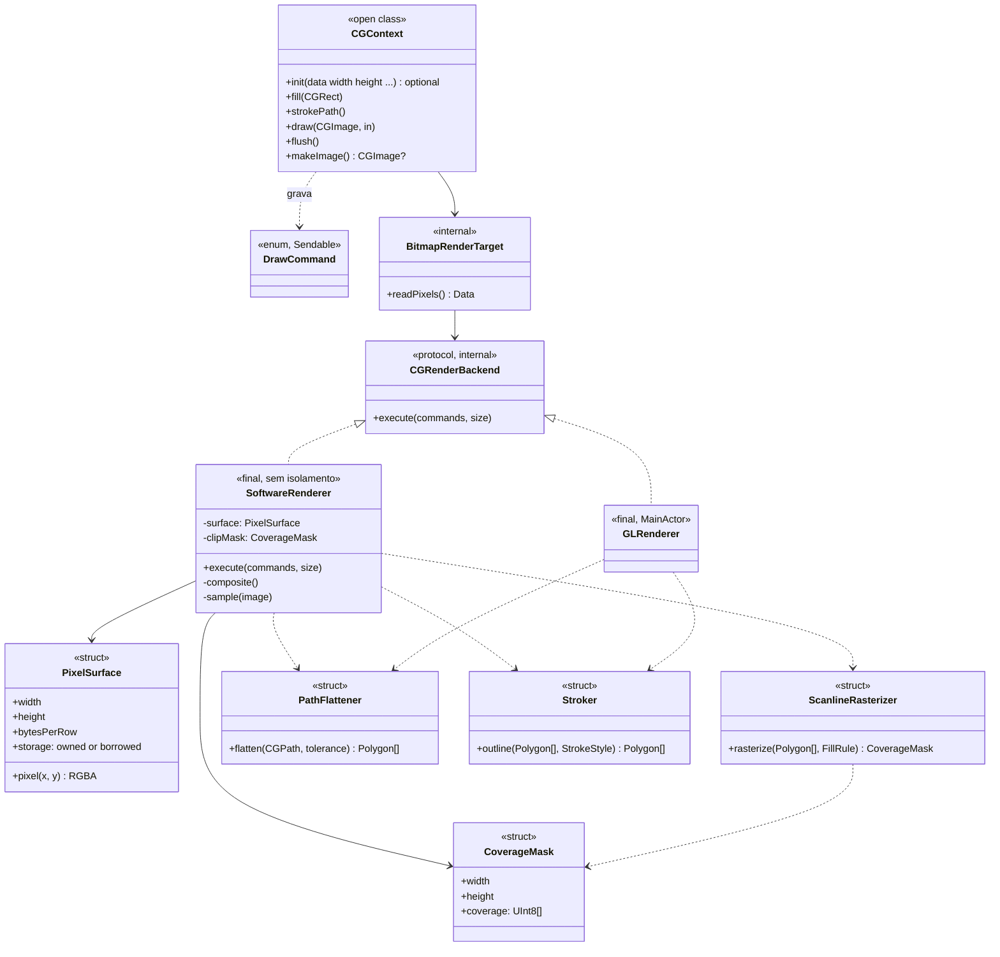
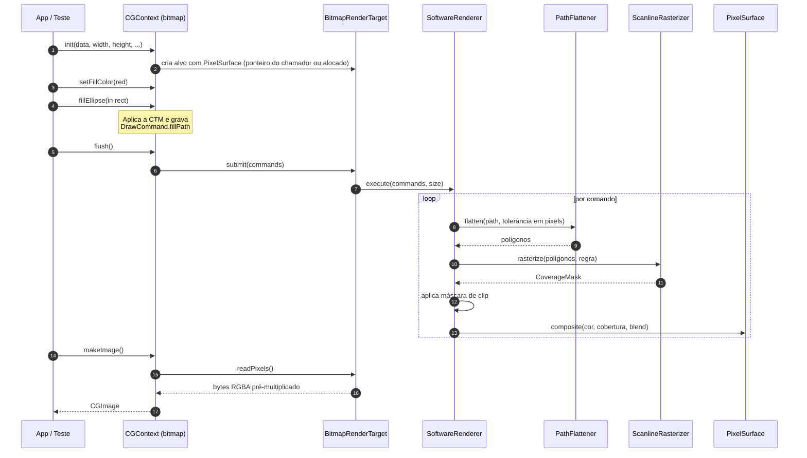

# ADR 0002 — Backend de renderização em software (bitmap sem OpenGL)

| Campo | Valor |
|---|---|
| **Status** | **Aceita** (Q8, Q9 e Q10 respondidas em 2026-11-09) |
| **Data** | 2026-11-09 |
| **Escopo** | Renderização de `CGContext` direto em memória (bitmap), sem contexto OpenGL |
| **Depende de** | [ADR 0001 — Análise arquitetural e reestruturação](0001-analise-arquitetural-e-reestruturacao.md) (camadas, `DrawCommand`, `CGRenderBackend`) |

---

## 1. Pergunta e resposta curta

> *"Se não tivermos um contexto do OpenGL, seria possível desenhar tudo diretamente como Bitmap?"*

**Sim.** Com a arquitetura da ADR 0001 isso é natural: o `CGContext` apenas grava `DrawCommand`, e quem os executa é um `CGRenderBackend`. Basta um segundo backend, o **`SoftwareRenderer`**, que rasteriza na CPU para um buffer de pixels. Ele não importa `OpenGLAD` nem `OpenGLFW` e roda em qualquer thread, inclusive nos testes.

Duas ressalvas honestas:

1. **Janela sem OpenGL não existe com o GLFW.** Sem GL é possível renderizar para memória, `makeImage()` e arquivo, mas não abrir janela. Mostrar o bitmap na tela exigiria uma textura GL (modo "software dentro da janela") ou código nativo (Win32/X11), que está fora de escopo.
2. **Desempenho:** a CPU serve bem para imagens pequenas e médias (ex.: 512×512). Em 4K, animações ou muitas camadas, o GL continua sendo o caminho.

## 2. Contexto

- O `CGContext(data:width:height:bitsPerComponent:bytesPerRow:space:bitmapInfo:)` existe na API pública, mas hoje **descarta o ponteiro `data`** e usa `Data()` vazio (`CGContext.swift:34-44`). Ou seja, o bitmap context não renderiza nada.
- Na API original da Apple, o *bitmap context* **é** um rasterizador em software que escreve em memória. Portanto o backend de software é a semântica fiel, e o OpenGL é a aceleração.
- A meta de 80 % de cobertura (R5) precisa de renderização verificável **sem GPU**. Um backend em software permite testar o resultado em pixels.
- O `OpenSTB` expõe apenas `stb_image` e `stb_truetype`: dá para ler imagens e rasterizar fontes na CPU, mas não gravar arquivos. A decisão (Q8) é usar **BMP**, formato simples de escrever e que o próprio `stb_image` já sabe ler.

## 3. Decisão

Criar o **`SoftwareRenderer`** como segundo `CGRenderBackend`, usado por padrão pelo contexto *bitmap* e disponível como referência para os testes do backend GL.

### 3.1 Quem usa qual backend

| Contexto | Destino | Backend |
|---|---|---|
| `CGWindow.cgContext` | Janela (framebuffer padrão) | `GLRenderer` |
| `CGContext(data:…)` (bitmap) | Memória do chamador ou alocada | **`SoftwareRenderer`** |
| `CGLayer` | Lista de `DrawCommand` | Executa no backend do contexto de destino |
| Testes | `RecordingRenderTarget` ou `BitmapRenderTarget` | Gravação ou `SoftwareRenderer` |

### 3.2 Geometria compartilhada

O `PathFlattener` e o `Stroker` (ADR 0001, seção 6.2) produzem **polígonos**, sem depender de backend. Cada backend os consome do seu jeito:

| Etapa | `GLRenderer` | `SoftwareRenderer` |
|---|---|---|
| Curvas → polilinhas | `PathFlattener` | `PathFlattener` (mesmo código) |
| Traço → polígonos | `Stroker` | `Stroker` (mesmo código) |
| Preenchimento | Triângulos + *stencil-then-cover* | `ScanlineRasterizer` (cobertura por amostragem) |

Assim, uma correção em elipse, *join* ou *dash* vale para os dois backends, e os testes de geometria cobrem ambos.

### 3.3 Rasterização

- **Cobertura anti-aliased:** varredura por *scanline* com amostragem 4×4 (16 níveis de cobertura) na primeira versão; evolução futura para cobertura exata por área.
- **Regras de preenchimento:** `winding` e `evenOdd` calculadas por contagem de cruzamentos por amostra.
- **Clip:** máscara de cobertura de 8 bits por pixel; a pilha de estados (`CGGraphicsState`) guarda a máscara atual.
- **Composição:** RGBA 8 bits **pré-multiplicado**, *source-over* de Porter-Duff. Todos os `CGBlendMode` separáveis são fórmulas simples por pixel, então o software suporta mais modos que o GL com blend fixo.
- **Imagens:** amostragem pela inversa da CTM; vizinho mais próximo ou bilinear conforme `interpolationQuality`; `byTiling` por módulo das coordenadas.
- **Cor:** a conversão `sRGB ↔ linear` fica em um único ponto compartilhado com o GL (ADR 0001, seção 6.5).

### 3.4 Memória e formato do bitmap

- `PixelSurface` é um `struct` que guarda `width`, `height`, `bytesPerRow` e o armazenamento:
  - se o chamador passou `data`, **usa esse ponteiro sem ser dono**, respeitando `bytesPerRow`;
  - se passou `nil`, **aloca** e libera no `deinit`.
- **Formatos da primeira versão (Q9: escolha técnica, sem restrição sua):**

  | Formato | `CGBitmapInfo` | Motivo |
  |---|---|---|
  | RGBA 8 bits, pré-multiplicado | `premultipliedLast` | Padrão atual do projeto e o mais comum na API da Apple |
  | BGRA 8 bits, pré-multiplicado | `premultipliedFirst` + `byteOrder32Little` | Formato nativo da Apple e do Windows (GDI/BMP); evita troca de canais ao exportar |
  | RGBX / BGRX 8 bits (opaco) | `noneSkipLast` / `noneSkipFirst` | Mesmo código com alfa fixo em 255; custo quase zero |

  Qualquer outro formato (CMYK, cinza, 16 bits, ponto flutuante) retorna falha explícita na primeira versão. O espaço de cor suportado é `sRGB` ou RGB linear.
- Como isso exige validar parâmetros, `CGContext.init(data:…)` vira **`init?`** (autorizado pela Q2, como o `CGBitmapContextCreate` da Apple, que retorna `NULL` em formato inválido).
- `makeImage()` cria um `CGImage` a partir dos pixels (cópia, como na Apple).

### 3.5 Concorrência (`/swift-concurrency-pro`)

- `SoftwareRenderer` e `PixelSurface` **não têm isolamento de ator**: não tocam OpenGL e podem rodar em qualquer thread.
- `CGContext` continua não `Sendable`, usado por uma thread por vez (como na API original). Não usamos `@unchecked Sendable`.
- A primeira versão é **síncrona e de thread única**. Se o desempenho exigir, o trabalho por faixa de linhas pode ser dividido com `withTaskGroup` e funções `@concurrent`, mantendo `flush()` síncrono para o chamador.

### 3.6 Exibir o bitmap na janela (entra na Fase 5, Q10)

Quando houver GL mas se queira o resultado do software (comparação visual, depuração), o `WindowRenderTarget` envia o `PixelSurface` como textura e desenha um quad de tela cheia. Só exige o `GLTextureCache` da Fase 4 e um programa `image/` de `Resources/`.

### 3.7 Exportação e imagens de referência em BMP (Q8)

- Um codificador **BMP** mínimo, interno ao pacote, grava 32 bits com cabeçalho `BITMAPV4HEADER` (preserva alfa) e linhas de cima para baixo. Cerca de 60 linhas e sem dependência nova.
- BMP guarda alfa **não pré-multiplicado**: a exportação converte a partir do `PixelSurface`.
- Leitura das imagens de referência: `stb_image` (já presente em `OpenSTB`) decodifica BMP, então o teste lê o arquivo de referência e compara com o resultado.
- Os arquivos de referência ficam em `Tests/OpenCoreGraphicsTests/Resources/` e são pequenos (ex.: 64×64).

## 4. Diagramas

### 4.1 Diagrama de classes

### 4.2 Diagrama de sequência — preencher uma elipse em um bitmap

## 5. Opções consideradas

| Opção | Prós | Contras |
|---|---|---|
| **A. Só OpenGL** | Um único backend | Bitmap context não funciona sem GPU; testes dependem de janela GL; a API pública `CGContext(data:…)` continua quebrada |
| **B. Bitmap via FBO + `readPixels`** | Reaproveita o GL | Ainda exige contexto GL (até para um bitmap), pouco portátil em servidores/VMs, difícil de testar |
| **C. Backend de software (escolhida)** | Funciona sem GPU, fiel à Apple, testável, serve de referência ao GL | Mais código para manter e risco de divergência visual entre backends |

**Decisão: C.** A divergência é mitigada por compartilhar comandos e geometria e por testes que comparam GL e software com tolerância.

## 6. Plano (Fase 5 da ADR 0001)

Ordem recomendada: Fases 0 → 1 → 2 (OpenGL, prioridade do projeto) → 3 (geometria compartilhada) → **5 (software)**. Como a Fase 3 já produz `PathFlattener` e `Stroker`, o software chega rápido depois dela.

| Passo | Entrega | Critério de saída |
|---|---|---|
| 5.1 | `PixelSurface` (próprio/emprestado), `init?` do bitmap `CGContext`, `makeImage()` | Teste: bitmap criado com ponteiro do chamador reflete as escritas |
| 5.2 | `SoftwareRenderer` com `fill(rect)` e composição *source-over* | Pixels exatos em retângulos opacos e semitransparentes |
| 5.3 | `ScanlineRasterizer` com AA 4×4 e regras `winding`/`evenOdd` | Elipse e estrela com cobertura dentro da tolerância |
| 5.4 | Traço (`Stroker` compartilhado), clip por máscara | Traço de largura N cobre ~N pixels; clip recorta |
| 5.5 | Imagens e `CGBlendMode` separáveis | Imagem desenhada no retângulo; tabela de blends testada |
| 5.6 | Exportação BMP e imagens de referência | Teste lê o BMP de referência e compara com o bitmap renderizado |
| 5.7 | Exibir o bitmap na janela (seção 3.6) | Sample mostra o resultado do software em uma `CGWindow` |
| 5.8 | Comparação GL × software (manual, sem CI) | Diferença média abaixo do limite acordado |

## 7. Testes (`/swift-testing-pro`)

- **Pixel a pixel** em superfícies pequenas (ex.: 8×8, 16×16) para retângulos, alfa e blends: resultados exatos.
- **Tolerância** para curvas e anti-aliasing (ex.: erro médio por canal ≤ 2/255).
- **Parametrizados** com `@Test(arguments:)` para cada `CGBlendMode`, regra de preenchimento e formato de bitmap.
- **Imagens de referência** em BMP (seção 3.7), lidas com `stb_image`; para casos mínimos, *arrays* de bytes embutidos no teste.
- Esses testes **não precisam de GPU** e contam para a meta de 80 %.

## 8. Consequências

**Positivas**
- O bitmap context passa a funcionar de verdade, como na API da Apple.
- Cobertura de testes de renderização sem GPU.
- Referência para validar o backend GL.
- Execução em ambientes sem OpenGL (servidores, contêineres, geração de imagens em lote).

**Negativas**
- Segundo rasterizador para manter.
- Desempenho limitado em resoluções altas.
- Diferenças sutis de anti-aliasing entre GL e software (aceitas como "melhor esforço").

**Riscos**

| Risco | Mitigação |
|---|---|
| Divergência visual entre backends | Geometria e comandos compartilhados; testes de comparação com tolerância |
| Formatos de bitmap demais para suportar | Lista fechada na primeira versão; falha explícita (`init?`) nos demais |
| Ponteiro emprestado do chamador ser liberado antes do uso | Documentar a regra de vida útil (igual à API da Apple) e não reter o ponteiro além do `CGContext` |
| Custo de CPU | Começar simples e medir; paralelizar por faixas de linhas só se necessário |

## 9. Decisões sobre as perguntas em aberto (2026-11-09)

| # | Pergunta | Decisão |
|---|---|---|
| **Q8** (ADR 0001) | Como exportar imagem? | **BMP**, com codificador mínimo no pacote. Sem PNG e sem alterar o `OpenSTB` |
| **Q9** | Formatos de bitmap da primeira versão | Escolha técnica: RGBA8 `premultipliedLast`, BGRA8 `premultipliedFirst` e as variantes opacas (seção 3.4) |
| **Q10** | Exibir o bitmap na janela | Entra na Fase 5 (passo 5.7) |

Sem perguntas em aberto nesta ADR.
