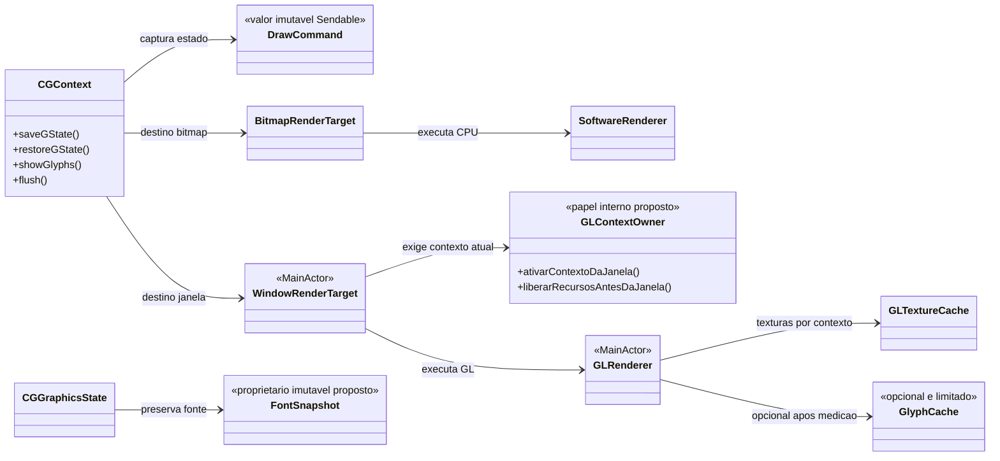
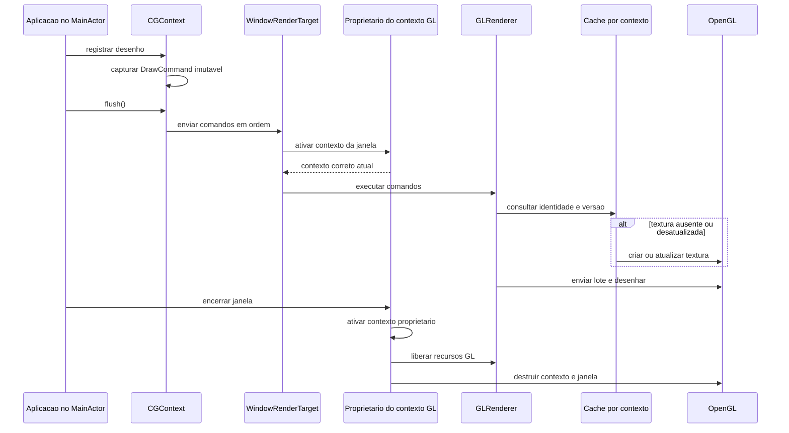

# ADR 0003 — Evolução da renderização, concorrência e qualidade

| Campo | Valor |
|---|---|
| **Status** | **Proposta** — pendente de validação e implementação |
| **Data** | 2026-11-10 |
| **Escopo** | Contextos OpenGL, concorrência, texto, caches, testes, análise estática e documentação |
| **Base de análise** | Revisão após as US-001 a US-062, sobre o commit `3522e86`, com alterações locais no Sample preservadas |
| **Relacionadas** | [ADR 0001 — Análise arquitetural e reestruturação](0001-analise-arquitetural-e-reestruturacao.md); [ADR 0002 — Backend de renderização em software](0002-backend-de-renderizacao-em-software.md) |

---

## 1. Resumo executivo

As ADRs anteriores introduziram comandos de desenho, renderização em software e OpenGL, caches e testes. A revisão posterior encontrou oportunidades para tornar essas camadas mais confiáveis, especialmente quando existem várias janelas ou quando dados mudam após entrar em um cache.

Esta ADR propõe uma evolução incremental, sem afirmar que as alterações já foram implementadas ou que todos os comportamentos suspeitos foram reproduzidos visualmente. A ordem recomendada é:

1. Garantir que cada operação e cada recurso OpenGL usem o contexto correto.
2. Tornar explícito o contrato de concorrência da janela sem impor isolamento de ator ao bitmap.
3. Investigar a comparação entre renderizadores, corrigir a orientação de glifos se confirmada e preservar a fonte no estado gráfico.
4. Corrigir invalidação e limites dos caches; só então otimizar o reaproveitamento de glifos com medições.
5. Automatizar testes e análises, ampliar a documentação e esclarecer o significado da cobertura.

**Princípio de compatibilidade:** preservar as declarações e o comportamento público existentes, conforme [AGENTS.md](../../AGENTS.md). Propostas que não possam ser realizadas internamente exigem uma decisão explícita sobre uma API aditiva ou eventual mudança incompatível; esta ADR não autoriza silenciosamente essa alteração.

## 2. Contexto e evidências

| Evidência | Observação | Confiança e limite |
|---|---|---|
| [`CGWindow`](../../Sources/OpenCoreGraphics/Services/Window%20Services/CGWindow.swift) | `glfwMakeContextCurrent` aparece na criação da janela, mas não nos caminhos usuais de desenho e destruição. | Evidência por leitura; o cenário de duas janelas precisa de teste de integração. |
| [`WindowRenderTarget`](../../Sources/OpenCoreGraphics/Rendering/GL/WindowRenderTarget.swift) e [`GLRenderer`](../../Sources/OpenCoreGraphics/Rendering/GL/GLRenderer.swift) | Conformidades a protocolos não isolados usam `MainActor.assumeIsolated`. | O contrato é verificado em runtime, não imposto pela assinatura do protocolo. |
| [`CGWindow`](../../Sources/OpenCoreGraphics/Services/Window%20Services/CGWindow.swift) | `makeKeyAndOrderFront` contém um loop síncrono até a janela fechar. | Enquanto estiver em execução, não há ponto de suspensão cooperativo nesse método. |
| [`SoftwareRenderer`](../../Sources/OpenCoreGraphics/Rendering/SoftwareRenderer.swift) e [`GLRenderer`](../../Sources/OpenCoreGraphics/Rendering/GL/GLRenderer.swift) | O mapeamento vertical das linhas do atlas de glifos difere entre os backends. | Divergência encontrada no código; a orientação correta e o resultado visual precisam de teste com máscara assimétrica. |
| [`CGContext`](../../Sources/OpenCoreGraphics/2D%20Drawing/CGContext.swift) e [`CGFont`](../../Sources/OpenCoreGraphics/Colors%20and%20Fonts/CGFont.swift) | O estado salva `font.fullName`; a restauração cria uma fonte novamente usando esse valor como caminho de arquivo. | A restauração depende da disponibilidade e do conteúdo do arquivo naquele momento. |
| [`CGDataProvider`](../../Sources/OpenCoreGraphics/Utility%20and%20Support%20Classes/CGDataProvider.swift), [`CGImageSnapshot`](../../Sources/OpenCoreGraphics/2D%20Drawing/CGImage.swift) e [`GLTextureCache`](../../Sources/OpenCoreGraphics/Rendering/GL/GLTextureCache.swift) | O provider é mutável; o snapshot mantém a identidade da imagem e o cache de imagens consulta essa identidade. | Uma mudança de bytes para a mesma identidade pode não atualizar a textura; é necessário teste de regressão ponta a ponta. |
| [`CGGlyphAtlas`](../../Sources/OpenCoreGraphics/Colors%20and%20Fonts/CGGlyphAtlas.swift), `CGContext` e `GLRenderer` | Um novo atlas é criado por comando; sua textura é removida do cache após o desenho. | A leitura indica rasterização e upload repetidos; o custo real deve ser medido. |
| [`GLSoftwareComparisonTests`](../../Tests/OpenCoreGraphicsTests/Rendering/GLSoftwareComparisonTests.swift) | Na revisão de 2026-11-10, o teste opt-in registrou diferenças acima da tolerância em cinco cenas; para o retângulo, média de 0,0827 contra limite de 0,00784. | O processo retornou código zero sem resumo final; não atribuir causa ao renderer ou ao ambiente antes de investigar. O teste de glifos também não produziu conclusão verificável. |
| [`coverage.md`](../tasks/coverage.md) | Cobertura registrada de 4.167/4.659 linhas, **89,44%**, após as US-060 a US-062. | O denominador exclui `Rendering/GL/` e `CGWindow.swift`; não representa todo o framework. |
| Build e testes | `swift build` e `swift test` com `-Xswiftc -strict-concurrency=complete` passaram na revisão; a saída informou 167 testes e duas suítes GL opt-in ignoradas. | O sucesso do compilador não prova correção de `assumeIsolated`, propriedade de contexto GL ou ausência de corridas em código nativo. |
| Análise C | O Clang Static Analyzer reportou uma atribuição não utilizada em [`stb_truetype.h`](../../Sources/OpenCoreGraphicsSTB/Private/stb_truetype.h), código de terceiros. | Um aviso observado, não uma avaliação exaustiva da dependência. |

## 3. Decisões propostas

### 3.1 Contexto OpenGL pertence à janela — prioridade alta

**Problema e importância.** Um contexto OpenGL é atual em uma thread, não em uma instância Swift. Criar uma segunda janela pode trocar o contexto atual; continuar a usar recursos da primeira janela sem reativar seu contexto pode desenhar no destino incorreto ou liberar recursos em um contexto inadequado.

**Proposta.**

- Associar explicitamente o contexto GLFW e o ciclo de vida de seus recursos à janela proprietária.
- Garantir que o contexto correspondente esteja atual antes de inicializar, desenhar, aplicar alterações de viewport/clip, ler pixels e liberar buffers, texturas e programas.
- Definir o comportamento quando a janela não existir mais e garantir que recursos sejam liberados **antes** da destruição do contexto. Não presumir que `@MainActor` escolhe automaticamente o contexto GL correto.
- Usar OpenGLAD para chamadas OpenGL e GLFW para seleção do contexto; evitar introduzir dependências novas.
- Isolar a seleção de contexto atrás de um colaborador testável, em vez de espalhar chamadas diretas em cada operação.

**Riscos e compromissos.** Trocar de contexto com frequência tem custo; callbacks de resize podem ocorrer durante o processamento de eventos; destruição e ordem dos `deinit` precisam de tratamento explícito. A estratégia deve especificar se restaura o contexto anteriormente atual e como lida com falhas, sem acessar objetos GL após o encerramento.

**Validação.** Testar uma janela A e uma B com conteúdo distinto, alternar desenhos e readbacks, redimensionar A enquanto B está atual e destruir A/B em ordens diferentes. Exercitar também o ciclo de vida por meio de um driver de teste sem GPU; executar integração com GL real nas plataformas disponíveis.

### 3.2 Fronteira de concorrência explícita — prioridade alta

**Problema e importância.** Os protocolos [`CGRenderTarget` e `CGRenderBackend`](../../Sources/OpenCoreGraphics/Rendering/CGRenderTarget.swift) são síncronos e não isolados. `MainActor.assumeIsolated` afirma que o chamador já está no ator principal; ele não desloca a execução para esse ator. Isso dificulta que o compilador ajude a impedir chamadas indevidas.

**Proposta.**

- Manter contextos e superfícies de bitmap independentes do ator principal, com uso exclusivo de cada instância mutável durante uma operação; eles não se tornam automaticamente seguros para acesso simultâneo.
- Separar internamente o contrato de execução de janela, isolado ao `MainActor`, do contrato síncrono usado por bitmap. Avaliar conformidades isoladas ou um adaptador especializado de janela, conforme as possibilidades reais do Swift e das APIs públicas existentes.
- Preservar snapshots imutáveis e `Sendable`, como `DrawCommand`, para transferência entre domínios de isolamento; não usar `@unchecked Sendable` apenas para eliminar diagnósticos.
- Documentar quem pode criar e usar cada contexto, e onde ocorrem as transições entre preparação de comandos e execução GL.
- Se a assinatura pública síncrona impedir uma garantia estática completa, registrar explicitamente o limite e avaliar API aditiva compatível, em vez de alegar segurança que o compilador não garante.

**Riscos e compromissos.** Uma separação inadequada pode deslocar trabalho para o ator errado, bloquear chamadas de bitmap ou alterar a ordem síncrona esperada por consumidores. Tornar um protocolo inteiro `@MainActor` resolveria parcialmente a janela, mas restringiria indevidamente o bitmap. Não introduzir `async` apenas como aparência de execução em paralelo.

**Validação.** Compilar em Swift 6 com verificação completa de concorrência; adicionar testes de bitmap em tarefas independentes, sem compartilhar uma instância mutável, e testes da fronteira de janela. Verificar também chamadas fora do ator por caminhos legados e documentar o comportamento suportado.

### 3.3 Integração cooperativa do loop da janela — prioridade alta

**Problema e importância.** O loop síncrono em `makeKeyAndOrderFront` processa eventos e desenha até o fechamento. Durante esse período, outras tarefas do `MainActor` não recebem um ponto de suspensão cooperativo pelo método; o loop também pode executar continuamente sem necessidade de novo frame.

**Proposta.** Investigar uma integração com o ciclo de eventos da plataforma ou uma operação de atualização incremental que permita ao chamador cooperar com o executor, mantendo a API atual funcional. Aplicar espera por eventos, sinalização de redesenho e/ou sincronização de apresentação conforme as capacidades da plataforma e as necessidades de animação.

**Riscos e compromissos.** Trocar polling por espera sem acordar para animações, timers e encerramento pode congelar a interface; depender de um loop nativo específico pode prejudicar Windows/Linux. Uma API assíncrona aditiva pode ser necessária para cooperação real e deve ser avaliada quanto a cancelamento, propriedade da janela e compatibilidade.

**Validação.** Verificar que uma tarefa agendada no ator principal progride enquanto a janela está aberta; testar eventos, animação, fechamento e múltiplas janelas. Medir uso de CPU em repouso e latência de resposta antes e depois.

### 3.4 Orientação e equivalência de glifos — prioridade alta

**Problema e importância.** As linhas de cobertura produzidas pelo stb são organizadas em coordenadas de bitmap descendentes. A geometria GL e a amostragem de software usam mapeamentos verticais diferentes; sem um padrão testado, texto assimétrico pode ser invertido em um backend.

**Proposta.**

- Definir uma convenção única para baseline, orientação das linhas da máscara e coordenadas do atlas, incluindo as transformações `textMatrix`, `textPosition` e CTM.
- Criar uma máscara sintética verticalmente assimétrica, com valores e posições conhecidos; verificar pixels em software e coordenadas/resultado GL, inclusive acima e abaixo da baseline.
- Comparar uma frase ou glifos assimétricos em uma sessão GL real, garantindo que os testes observem o framebuffer correto. Corrigir o backend que divergir da convenção validada.

**Riscos e compromissos.** Corrigir uma inversão muda resultados para clientes que tenham se adaptado ao comportamento anterior. Transformações com escala negativa, rotações, espaçamento e bordas bilineares podem esconder erros se os testes usarem apenas glifos simétricos.

**Validação.** Exigir teste determinístico de pixels assimétricos, teste de transformações e comparação GL/software concluída com resultado inequívoco. Não considerar uma execução sem resumo final como sucesso.

### 3.5 Preservar a fonte no estado gráfico — prioridade alta

**Problema e importância.** `saveGState()` salva o nome/caminho da fonte; `restoreGState()` relê o arquivo. O arquivo pode ser removido, modificado ou estar inacessível, produzindo um estado diferente do salvo. Cada restauração também pode executar I/O e novo parsing.

**Proposta.** Preservar, no estado interno, um proprietário ou snapshot imutável dos dados necessários à fonte originalmente selecionada. Separar essa propriedade do nome público mutável; evitar tornar `CGFont` indiscriminadamente `Sendable`. Manter uma representação segura para snapshots que precisem atravessar atores, sem alterar a API pública existente.

**Riscos e compromissos.** Manter dados de fontes vivos aumenta o uso de memória e exige gestão correta da vida útil da ponte stb. Compartilhar estado nativo mutável entre threads sem proteção seria incorreto. Reabrir o arquivo por caminho é simples, mas não satisfaz a semântica de restauração fiel.

**Validação.** Salvar e restaurar estados aninhados com fontes e tamanhos diferentes; após salvar, alterar ou remover uma cópia temporária do arquivo e confirmar que a fonte original continua desenhando. Testar ausência de fonte e restauração repetida.

### 3.6 Cache de imagens: conteúdo e ciclo de vida — prioridade alta

**Problema e importância.** O provider pode mudar seus bytes, enquanto o cache usa a identidade estável da imagem para reutilizar a textura. Dessa forma, o software pode consumir um snapshot novo enquanto GL continua com pixels antigos. Além disso, as entradas de imagem não têm política automática de limite no fluxo de renderização.

**Proposta.**

- Estabelecer uma única regra de identidade e conteúdo: por exemplo, manter snapshots imutáveis com versão de conteúdo e atualizar a textura quando a versão mudar. Avaliar como capturar mudanças feitas por meio do provider público, sem quebrar a API existente.
- Definir limite de memória e política de descarte, como LRU por bytes, respeitando o contexto GL proprietário; explicitar o comportamento em pressão de memória e destruição da janela.
- Separar invalidação de conteúdo de descarte de recurso. Não reutilizar uma textura para pixels novos simplesmente porque o identificador do objeto é o mesmo.

**Riscos e compromissos.** Hashing de todo o bitmap a cada desenho pode custar mais do que o upload; versionamento deve cobrir todas as formas de mutação. Descartar uma textura ainda referenciada por um lote pendente pode causar falha de desenho; flush e ordem de vida útil precisam ser testados.

**Validação.** Desenhar uma imagem, alterar o provider, desenhar novamente e comparar os pixels dos dois backends; testar reutilização sem alteração, atualização, descarte por limite e liberação no contexto correto. Medir memória e uploads.

### 3.7 Cache de glifos e limites do atlas — prioridade média

**Problema e importância.** Cada `showGlyphs` rasteriza os glifos novamente, gera um atlas com nova identidade e o renderer GL remove sua textura após o desenho. Isso preserva uma vida útil simples, mas não oferece reaproveitamento entre comandos ou frames.

**Proposta.**

- Medir rasterizações, uploads, tempo de frame e memória em texto estático e dinâmico antes de introduzir cache.
- Caso os dados justifiquem, usar cache limitado de máscaras ou atlas por identidade imutável da fonte, tamanho e demais parâmetros que alterem a rasterização. Cor, posição e transformação não devem invalidar a máscara se não alterarem os pixels rasterizados.
- Definir eviction por orçamento de bytes, sincronização com lotes e propriedade por contexto GL. Comparar um atlas por comando, atlas paginados e cache de máscaras na CPU; não pressupor que um único atlas ilimitado é suficiente.
- Considerar `GL_MAX_TEXTURE_SIZE` e falhas de alocação/upload; strings longas podem ultrapassar o tamanho máximo se todos os glifos forem empacotados em uma única linha. Planejar páginas ou divisão em lotes e tratamento explícito de erro.

**Riscos e compromissos.** Cache incorreto pode reutilizar cobertura de outra fonte ou tamanho; um atlas mutável pode alterar comandos já registrados; paginação aumenta draw calls. Limites e métricas devem evitar crescimento ilimitado de CPU e GPU.

**Validação.** Testar repetição, fontes/tamanhos distintos, invalidação, eviction e textos maiores que o limite de textura simulado. Verificar equivalência visual, número de rasterizações/uploads e consumo sob carga.

### 3.8 Testes visuais, análise estática e CI — prioridade alta para confiabilidade

**Problema e importância.** A suíte padrão não executa testes GL opt-in, e os resultados observados na comparação não tiveram encerramento inequívoco. A cobertura de 89,44% também exclui o backend GL e a janela. Portanto, build verde e cobertura do núcleo não demonstram equivalência visual.

**Proposta.**

- Investigar a infraestrutura de teste e o readback: contexto atual, resolução real do framebuffer, estado de cor, MSAA, sincronização e ciclo de vida. Separar problemas do ambiente de divergências reais de pixels.
- Fazer o runner de integração reportar falhas e encerramento de forma verificável, inclusive quando o processo Swift Testing retornar código zero após uma saída incompleta. Estabelecer timeout e registrar ambiente, driver, dimensões, tolerâncias e artefatos de comparação.
- Manter testes unitários sem GPU no fluxo comum e criar job GL opt-in ou dedicado em infraestrutura com contexto gráfico apropriado; não prometer execução de GPU em runners que não a ofereçam.
- Usar `swift build`, `swift test`, verificação completa de concorrência e cobertura com escopo explícito. Incluir testes de janela, cache, glifos e preservação de estado.
- Automatizar análise estática e formatação a partir de uma baseline acordada. Avaliar SwiftLint se estiver disponível, `swift-format` e Clang Static Analyzer para a ponte C; documentar e isolar avisos de terceiros sem escondê-los indiscriminadamente.
- Avaliar builds e testes em macOS, Linux e Windows, respeitando as limitações reais do Swift, GLFW, drivers e infraestrutura de cada plataforma.

**Riscos e compromissos.** Comparações por média global podem deixar passar falhas localizadas; diferenças de antialiasing ou conversão de cor podem variar por driver. Tolerâncias devem ser justificadas por cenário, não ampliadas apenas para tornar o teste verde. Novas ferramentas ou infraestrutura devem ser adotadas separadamente e sem dependências não aprovadas.

**Validação.** O CI deve indicar claramente testes executados, ignorados e falhos; uma falha visual intencional deve falhar o job. Manter a meta de pelo menos 80% no escopo acordado e publicar também a cobertura dos componentes excluídos quando mensurável, sem misturar denominadores.

### 3.9 Documentação e clareza da API — prioridade média

**Problema e importância.** [`CGFont.init?(_:)`](../../Sources/OpenCoreGraphics/Colors%20and%20Fonts/CGFont.swift) é documentado em termos de nome PostScript ou nome completo, mas lê um caminho de arquivo. O [README](../../README.md) não descreve adequadamente fontes, isolamento, execução dos testes gráficos ou limitações de renderização.

**Proposta.**

- Corrigir a documentação de `CGFont` para refletir o comportamento atual e dar exemplo de caminho; considerar uma API de nome de fonte somente como evolução separada.
- Documentar contratos de propriedade, isolamento e vida útil de contextos e buffers, depois de estabilizar as decisões das seções 3.1 e 3.2.
- Descrever como executar o Sample e fornecer `--font`, os testes padrão e GL opt-in, pré-requisitos por plataforma, escopo da cobertura e diagnóstico de falhas.
- Vincular as limitações já documentadas de [sombras](../ShadowRendering.md), [blend GL](../GLBlendModeMapping.md) e [gradientes](../Gradients.md); não apresentar essas capacidades como completas em todos os backends.
- Revisar a precisão das declarações públicas relacionadas às mudanças, preservando nomes existentes e evitando refatorações meramente cosméticas.

**Riscos e compromissos.** Documentar comportamento aspiracional como implementado confunde consumidores. Alterações na API pública exigem avaliação de compatibilidade; correções de texto não devem prometer fidelidade visual ainda não verificada.

**Validação.** Conferir os exemplos contra os comandos e caminhos efetivos e distinguir funcionalidades implementadas, fallback e trabalho futuro. Validar links relativos e documentação após mudanças relacionadas.

## 4. Arquitetura proposta

Os nomes dos colaboradores abaixo descrevem **papéis**, não tipos já existentes nem uma exigência de adicionar declarações públicas. A implementação concreta deve respeitar as restrições do projeto.

### 4.1 Class Diagram

### 4.2 Sequence Diagram — desenho e ciclo de vida de janela

O caminho de bitmap permanece síncrono e não usa o proprietário de contexto GL. A transferência de comandos entre executores, se introduzida, deve ser explícita e preservar a ordem.

## 5. Alternativas consideradas

| Alternativa | Vantagem | Motivo para não adotá-la como solução geral |
|---|---|---|
| Deixar o contexto GL atual implicitamente | Menos código e nenhuma troca adicional em uma única janela. | Não estabelece propriedade correta quando outra janela muda o contexto atual. |
| Marcar todo o pipeline como `@MainActor` | Modelo uniforme para janela e recursos GL. | Restringe bitmap independente e não seleciona o contexto OpenGL correto. |
| Manter somente `assumeIsolated` | Preserva protocolos síncronos atuais. | Continua dependendo de uma precondição de runtime sem contrato estático para chamadores. Pode ser transição documentada, não garantia final. |
| Reabrir fonte no `restoreGState()` | Estado pequeno e fácil de serializar. | Acrescenta I/O e depende do estado externo do arquivo. |
| Desativar todos os caches | Invalidação simples. | Corrige estaleness às custas de rasterização e upload repetidos; não resolve sozinho limites de textura. |
| Cache ilimitado por identidade | Reutilização simples. | Pode exibir dados desatualizados e crescer indefinidamente. |
| Rodar todas as comparações GL no teste padrão | Feedback visual em toda execução. | Exige driver e display que podem não existir; usar suíte dedicada com resultado explícito. |
| Aumentar as tolerâncias atuais | Reduz falhas observadas. | Não explica diferenças nem protege contra regressões; exige primeiro análise por cenário. |

## 6. Plano incremental e critérios de aceite

| Fase | Entregas | Critérios verificáveis |
|---|---|---|
| **0 — Diagnóstico reproduzível** | Tornar conclusivo o runner GL; registrar ambiente e diferenças atuais; estabelecer baseline de desempenho. | Teste que falha produz falha do job; nenhuma saída incompleta é contada como aprovação; métricas e limitações registradas. |
| **1 — Contexto GL e isolamento** | Propriedade de contexto por janela, ordem de teardown e fronteiras de concorrência explícitas. | Testes de duas janelas, callbacks e destruição; build Swift com verificação completa; bitmap continua independente do ator principal. |
| **2 — Correção de texto e estado** | Convenção vertical validada; preservação da fonte em estados salvos. | Máscara assimétrica, transformações, baseline e restauração após alteração/remoção da fonte passam; comparação real é concluída. |
| **3 — Caches** | Invalidação correta de imagens, política limitada e otimização de glifos se sustentada por medições. | Pixels atualizados, limites e eviction testados; benchmarking de tempo, uploads e memória; texto longo tratado sem exceder limite GL. |
| **4 — Qualidade e documentação** | CI por capacidade, análise estática com baseline, documentação pública e guias de execução. | Resultados e exclusões explícitos; metas de cobertura verificadas no escopo acordado; exemplos e links conferidos. |

As fases podem ter entregas menores. A fase 0 é pré-requisito para usar comparações visuais como evidência; a propriedade de contexto da fase 1 deve preceder o gerenciamento de recursos GPU das fases seguintes. Testes unitários devem acompanhar cada mudança, não ficar reservados à fase 4.

## 7. Consequências

**Benefícios esperados:** desenho e liberação associados à janela correta; contratos de isolamento mais claros; restauração fiel de fonte; imagens atualizadas; maior confiança em texto e paridade entre renderizadores; controle de memória e diagnósticos mais úteis.

**Custos e riscos:** maior complexidade no ciclo de vida GL, testes dependentes de infraestrutura gráfica, possibilidade de mudanças visuais ao corrigir bugs, custo de memória para preservar fontes e necessidade de manutenção das políticas de cache. O desempenho de caches e de trocas de contexto deve ser comprovado, não presumido.

**Fora do escopo imediato:** implementação de novas funcionalidades de sombras ou de todos os modos de blend no GL; introdução de dependências externas; alteração incompatível da API pública; afirmar que a cobertura parcial representa todos os caminhos de GPU.

## 8. Questões em aberto

1. Qual mecanismo cooperativo preserva a compatibilidade da API de janela e funciona nas plataformas alvo?
2. A separação interna de protocolos e adaptadores consegue garantir isolamento sem alterar declarações públicas? Se não, qual API aditiva será proposta?
3. Qual configuração de framebuffer, cor, sincronização e runner explica as diferenças da comparação opt-in observadas em 2026-11-10?
4. Qual representação imutável da fonte preserva a vida útil da ponte C sem compartilhamento inseguro?
5. Que mecanismo de versão detecta todas as alterações permitidas no provider sem copiar ou calcular hash de todo o bitmap em cada desenho?
6. Quais limites de memória, política de eviction e desenho de atlas são adequados após medições reais?
7. Que runners e drivers gráficos estão disponíveis para testar GL em macOS, Linux e Windows?

## 9. Estado da decisão

Esta ADR registra **sugestões para avaliação**. A aceitação das escolhas em aberto, a criação de tarefas e a implementação devem ocorrer separadamente. As evidências e os números aqui refletem a revisão de 2026-11-10 e devem ser atualizados quando novos testes forem executados.
